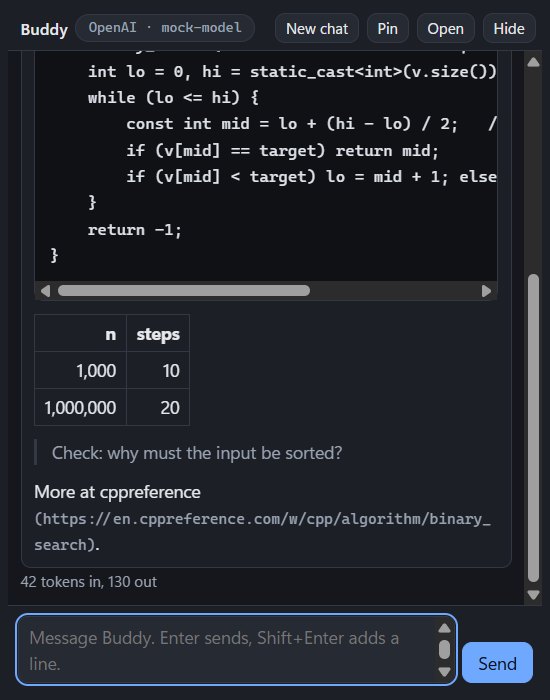
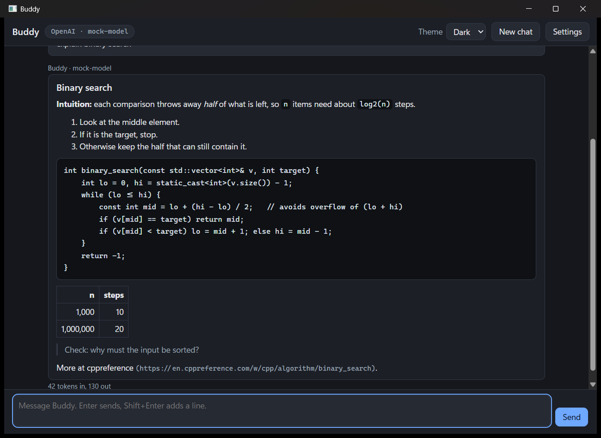
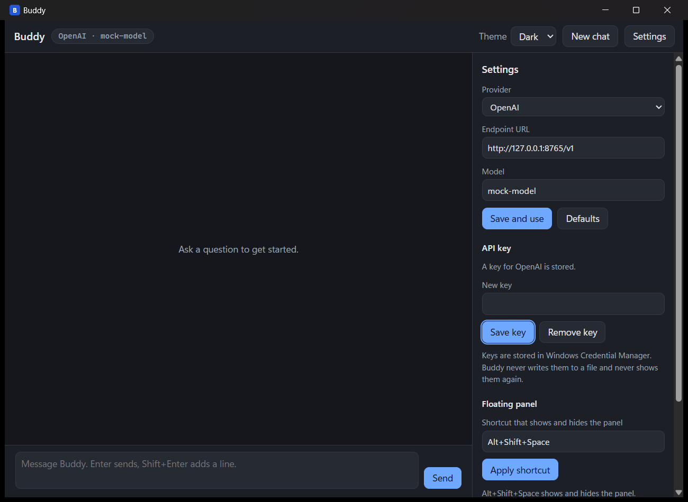

# Buddy

Buddy is a native Windows AI companion that sits next to your cursor. Press a hotkey over any
app, a small panel appears beside the mouse, you type a question, and the answer streams in.
Press Esc and you are back in the app you were using.

The longer-term goal is a tutor that can see the screen, listen, draw on top of other apps and
guide you through them step by step. **Most of that is not built yet.** See
[Status](#status) for exactly what works today.

Buddy is an independent project. It is inspired by HeyClicky but is **not affiliated with,
endorsed by, or derived from HeyClicky**, and contains none of its code or assets.

**Models and servers are your own.** Buddy does not include, download or run any AI model. It
connects to a model provider you choose and pay for, with an API key you supply.

| Floating panel | Main window | Settings |
|---|---|---|
|  |  |  |

The screenshots show replies from the bundled mock server, not from a real model.

## Status

Early development. Of thirteen milestones, the planning one is done and two are built. Nothing has been released as an installer.

| Milestone | State |
|---|---|
| M0 Plan and environment audit | Done |
| M1 App skeleton: Win32 host, WebView2 UI, themes, provider interface, OpenAI-compatible client | Built |
| M1.5 Companion shell: tray icon, single instance, global hotkey, floating panel | Built |
| M2 Local model servers: discovery, model list, capability detection | Not started |
| M3 Voice: push-to-talk, speech-to-text, text-to-speech | Not started |
| M4 Screen overlay, screen capture, on-screen drawing | Not started |
| M5a Element grounding and step-by-step guidance | Not started |
| M5b Rider integration (plugin) | Not started |
| M6 Visuals panel (diagrams, plots, interactive examples) | Not started |
| M7 Model router | Not started |
| M8 Theme UI and polish | Not started |
| M9 Rider profile | Not started |
| M10 Installer and packaging | Not started |

What works today:

- A tray icon with Open, Settings, Mute and Quit. One instance at a time. Starts hidden.
- A global hotkey (default `Alt+Shift+Space`, configurable) that toggles a floating panel next to
  the cursor. Esc hides it and returns focus to the previous window.
- Text chat with streamed replies, Markdown and code blocks, in the panel and the main window.
- Light and dark themes from JSON files, switchable at run time.
- API keys stored in Windows Credential Manager.

Known gaps, stated plainly:

- **It has only been tested against a mock server.** No request has yet been made to a real
  provider from this code. The Anthropic endpoint was checked against Anthropic's documentation.
- It talks to providers through the OpenAI-compatible chat API only. Anthropic describes its
  compatibility endpoint as meant for testing, not production; a native adapter is planned.
- The OpenAI entry has no default model: you type the model id yourself.
- No screen capture, no voice, no overlay drawing, no guidance, no local-server discovery.
- "Mute" is stored but does nothing until speech exists.
- Tested on one machine: Windows 11, one display at 125 % scale. Windows 10, multiple monitors,
  mixed DPI and other GPU vendors are untested. Pressing the hotkey for real, and dragging or
  resizing the panel with the mouse, were not covered by the automated checks.

[STATUS.md](STATUS.md) has the full record: decisions, what was tested and how, and the list of
untested paths. [TESTING.md](TESTING.md) is the consolidated end-to-end checklist for final
owner testing. [PROJECT.md](PROJECT.md) is the design brief.

## Build from a clean machine

Requirements:

- Windows 10 or 11, x64.
- **Visual Studio 2026 Build Tools** (or Visual Studio) with the *Desktop development with C++*
  workload. Make sure these components are ticked: *C++ CMake tools for Windows* and
  *vcpkg package manager*. Only the 2026 Build Tools (MSVC 14.51) have been tried.
- **Git**.
- The **Microsoft Edge WebView2 Runtime**. It is part of Windows 11. On Windows 10, install the
  Evergreen runtime from Microsoft.
- An internet connection for the first build, which downloads the dependencies listed in
  `vcpkg.json` (a few minutes).

Steps, from a normal Command Prompt:

```bat
git clone https://github.com/NandanGorla/Yo_Buddy
cd Yo_Buddy
scripts\build.cmd
```

That configures, builds and runs the unit tests for the debug preset. For an optimised build use
`scripts\build.cmd release`. Add `notest` to skip the tests.

The script finds Visual Studio and its bundled vcpkg by itself. In CLion or Visual Studio, open
the folder and choose the `msvc-debug` or `msvc-release` CMake preset instead.

The web UI in `ui/` is plain HTML, CSS and JavaScript. It has no build step and needs no Node.js.

## Run

```bat
build\msvc-release\buddy.exe
```

1. On first run the main window opens. Later runs start in the tray.
2. Open **Settings**, pick a provider, and paste your API key. For OpenAI, also type a model id.
3. Press `Alt+Shift+Space` over any app to summon the panel. Esc hides it.
4. Quit from the tray icon's menu. Closing the window only hides it.

To try it without an API key, start the mock server that is built alongside the tests:

```bat
build\msvc-debug\buddy_mock_server.exe --port 8765
```

Then in Settings choose **OpenAI**, set the endpoint URL to `http://127.0.0.1:8765/v1`, and enter
any model name. The mock server returns canned replies.

Buddy keeps its data in `%LOCALAPPDATA%\Buddy` (settings, a log, the WebView2 profile). Deleting
that folder resets it. API keys are separate: remove them in Settings or in Windows Credential
Manager, where they appear as `Buddy/apikey/<provider>`.

## Privacy

- **What is sent:** the text you type, the earlier messages of the current conversation, and a
  short fixed system prompt. Nothing else. This version cannot capture the screen or the
  microphone.
- **Where it goes:** only to the endpoint URL shown in Settings, over HTTPS. Plain HTTP is
  accepted only for a server on your own PC (loopback). What the provider does with your text is
  governed by that provider's terms, not by Buddy.
- **API keys** are stored in Windows Credential Manager, never in a file, and are sent only as
  the authorization header of requests to the endpoint you configured.
- **No telemetry.** Buddy has no analytics and does not phone home. The log file stays on your PC
  and records events and error codes, not message text.
- **The UI cannot reach the network.** All requests are made by the native host; the web UI is
  blocked from making any.
- Conversations are kept in memory only and are gone when Buddy quits.

Later milestones will add screen capture and voice. Those will come with their own controls
(an exclusion list, a preview before anything goes to a cloud provider) and this note will be
updated when they do.

## Repository layout

```
src/core/        protocol, settings, themes, hotkey and placement logic (no Windows headers)
src/providers/   chat provider interface and the OpenAI-compatible client
src/platform/    WinHTTP transport, Credential Manager, known folders
src/webhost/     the WebView2 control and its lock-down
src/app/         the Win32 host: tray, hotkey, main window, floating panel
ui/              the web UI, with vendored libraries under ui/vendor/
themes/          theme files
tests/           unit tests and the mock server
spikes/          throw-away experiments kept for the record (not built by default)
```

## License

Buddy is released under the MIT License: see `LICENSE`.
Third-party components and their licenses are listed in
[THIRD_PARTY_NOTICES.md](THIRD_PARTY_NOTICES.md).
